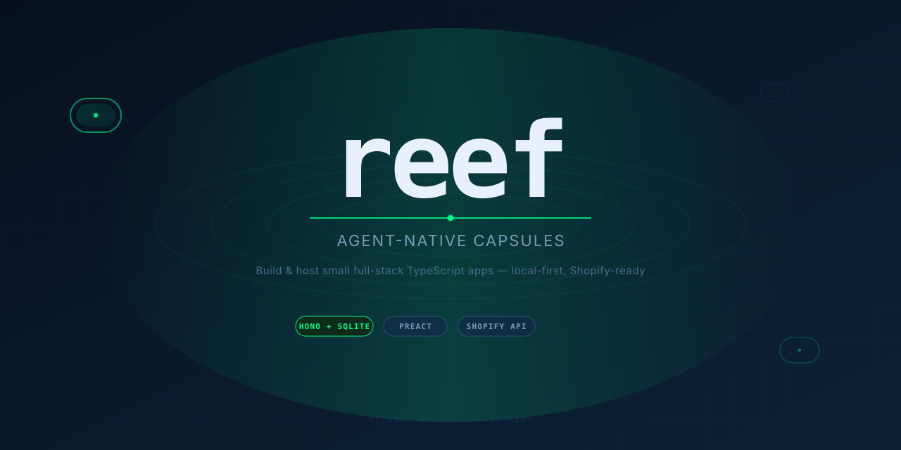
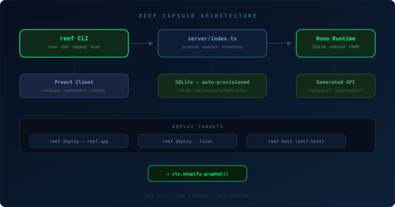
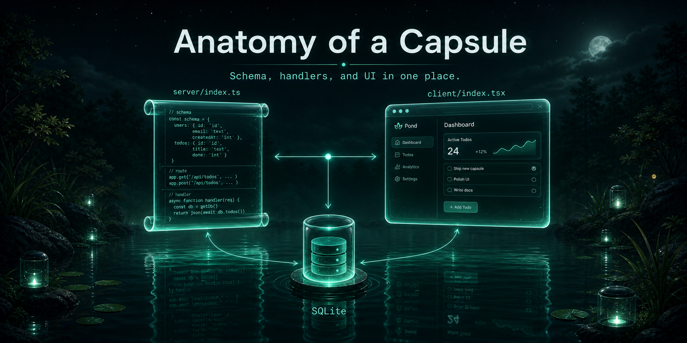
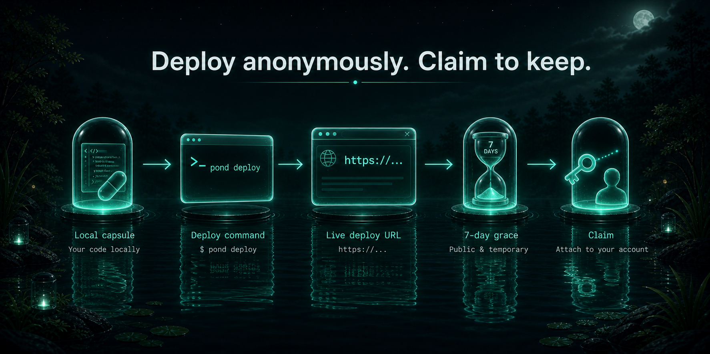
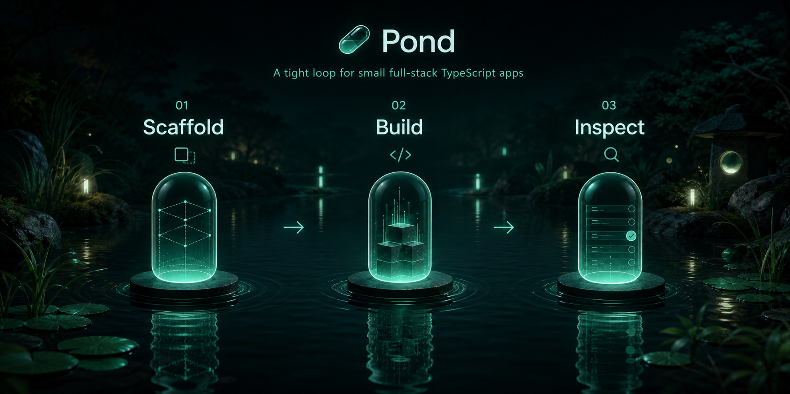
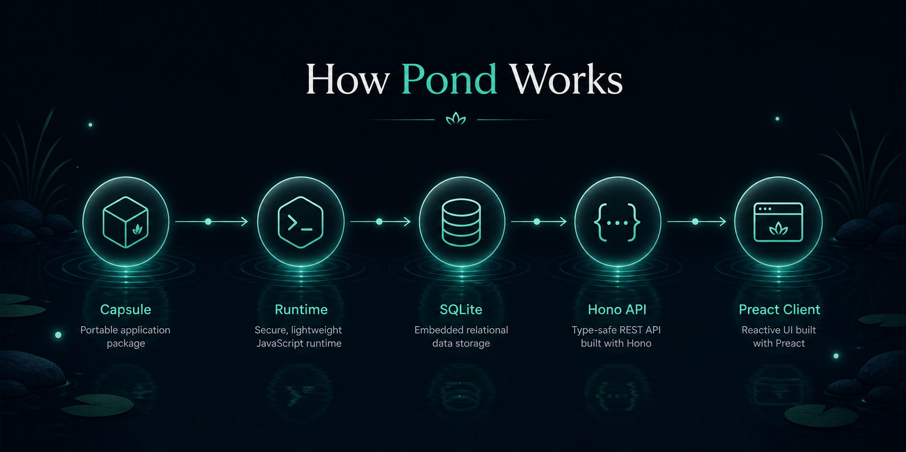
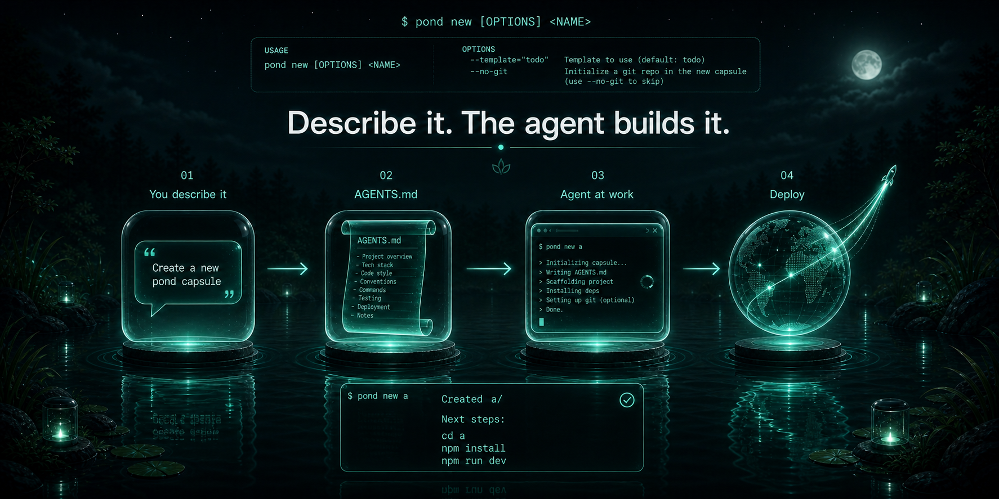
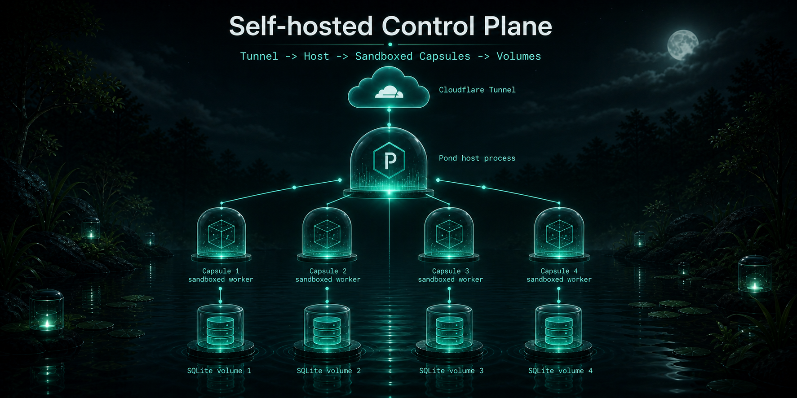

<p align="center">
  
</p>

<p align="center">
  <a href="https://www.npmjs.com/package/reefsh"></a>
  
  
  
  
  
</p>

<p align="center">
  <strong>Agent-native CLI and runtime for small full-stack TypeScript apps.</strong><br />
  <span>Define your schema and handlers in one file, run locally with zero config, deploy when ready — with built-in Shopify when you need it.</span>
</p>

<p align="center">
  <a href="#quickstart">Quickstart</a> ·
  <a href="#what-a-capsule-looks-like">Capsule</a> ·
  <a href="#cli">CLI</a> ·
  <a href="docs/api-reference.md">Server API</a> ·
  <a href="docs/client-reference.md">Client API</a> ·
  <a href="docs/operations.md">Operations</a> ·
  <a href="docs/mcp.md">MCP</a>
</p>

---

## What is Reef

Reef builds **capsules** — small, full-stack TypeScript apps with a single-file server definition:

- **Schema, queries, mutations, and endpoints** live together in `server/index.ts`
- **SQLite** is auto-provisioned — tables are created from your schema, no migrations
- **Hono** serves generated routes: `GET /api/query/*` and `POST /api/mutation/*`
- **Preact** on the client — `useQuery`, `useMutation`, and `useAuth` with no extra plumbing
- **Every capsule gets `ctx.shopify.graphql()`** for the Shopify Admin API when you need it

Reef is open-source and designed for a tight inner loop:

1. `reef new` — scaffold a capsule
2. Define your capsule in `server/index.ts`
3. `reef dev` — compile, provision SQLite, bundle the client, serve with live reload

<p align="center">
  
</p>

## Why Reef

| | |
|---|---|
| **Single-file server model** | Schema, queries, mutations, and endpoints in one capsule definition — no scattered files |
| **Zero-config local runtime** | esbuild + Hono + SQLite auto-creation; tables, routes, and typed contexts generated for you |
| **No client plumbing** | Preact hooks call generated routes directly — no API client to write |
| **Agent-friendly by design** | Small CLI, inspectable contracts, `AGENTS.md` scaffolding — `reef new "a dashboard for X"` writes the brief and an agent fills it in |
| **Real dev ergonomics** | Live reload, guest identity switching, DB inspection, structured logs, and a deploy bundle path built in |
| **Browser IDE for hosted capsules** | After `reef deploy`, open `/ide/<id>` to edit `server/`, `client/`, and `shared/` with live diagnostics |

## What a Capsule Looks Like

```ts
import { capsule, mutation, query, string, table } from "reef/server"

export default capsule({
  schema: {
    messages: table({
      body: string(),
    }),
  },

  queries: {
    messages: query((ctx) => ctx.db.messages.orderBy("createdAt", "desc").all()),
  },

  mutations: {
    sendMessage: mutation((ctx, body: string) => ctx.db.messages.insert({ body })),
  },
})
```

<p align="center">
  
</p>

That one definition becomes:

- a SQLite-backed `messages` table (auto-created)
- `GET /api/query/messages`
- `POST /api/mutation/sendMessage`
- a typed runtime context with `db`, `auth`, `env`, `log`, and `shopify`

---

## Quickstart

No install required — `npx` runs the latest release:

```bash
npx reefsh new my-capsule
cd my-capsule
npm install && npm run dev
```

Open `http://localhost:3000`.

### Shopify quickstart

```bash
npx reefsh new my-shopify-app --template shopify
cd my-shopify-app
```

Edit `.env.reef.server`:

```
SHOPIFY_SHOP=my-store.myshopify.com
SHOPIFY_TOKEN=***
```

```bash
npm install && npm run dev
```

Products are listed at `http://localhost:3000`. See [`docs/api-reference.md`](docs/api-reference.md#ctxshopify) for `ctx.shopify.graphql()`.

> Prefer a global install? `npm install -g reefsh` — then use `reef` directly.

### Let an agent build it

Anything after `reef new` that isn't a single slug is a build prompt. With `--generate`, Reef hands it to a local agent (`hermes`, `claude`, or `codex`):

```bash
npx reefsh new "a habit tracker inspired by twitch" --generate
# → creates ./habit-tracker-inspired-by-twitch/
# → writes AGENTS.md + .claude/CLAUDE.md with the brief + capsule contract
# → invokes the local agent headlessly to build server/ + client/
```

Without `--generate`, the stub + `AGENTS.md` is scaffolded for you to open in Claude Code / Cursor:

```bash
npx reefsh new "a dashboard for hermes-agent"
```

Use `--dir my-app` to override the auto-slugged directory, `--no-git` to skip `git init`.

#### Windows

`reef new` and `reef fork` run `git init` — install [Git for Windows](https://git-scm.com/download/win) or pass `--no-git`. `reef host` (self-hosting the control plane) is Linux-only.

> Reef never calls a remote LLM — `--generate` only invokes whatever agent CLI is on your `PATH`.

### Anonymous hosted deploy

<p align="center">
  
</p>

If a public Reef host is running (e.g. `reef.app`):

```bash
reef deploy --api https://reef.app
# → https://abc123def4567890.reef.app
# → IDE: https://reef.app/ide/abc123…#token=<claim>
# → claim token saved to .reef/deploy.json (valid 7 days)
```

Claim it to keep it:

```bash
reef claim --signup <username>
```

See [`docs/operations.md`](docs/operations.md) to self-host on Oracle Always Free + Cloudflare Tunnel (~$10/yr).

---

## Developer Loop

```bash
reef new chat-demo
cd chat-demo
npm install
reef dev
```

Reef will:

- scaffold `server/index.ts`, `client/index.tsx`, `shared/`, and `.env.reef.server`
- initialize a git repository
- compile the capsule with esbuild and create `.reef/data.db` + tables
- bundle the Preact client and serve an HTML shell
- watch `server/index.ts`, `client/index.tsx`, `shared/`, and `.env.reef.server` — push reloads over `/__reef_reload`

<p align="center">
  
</p>

## CLI

| Command | Purpose |
|---|---|
| `reef new <name>` | Scaffold a new capsule from a template |
| `reef new <description...>` | Scaffold + write `AGENTS.md` for an agent to build |
| `reef new <desc> --generate` | Scaffold and invoke a local agent headlessly |
| `reef dev --port 3000` | Run the local dev server with live reload |
| `reef deploy` | Deploy to `reef.app` — prints live URL + claim token |
| `reef deploy --api <url>` | Deploy to a different host (e.g. self-hosted) |
| `reef deploy --local` | Build a standalone bundle for `reef start` |
| `reef claim` | Claim an anonymous deploy with its token |
| `reef start` | Start a locally bundled deploy artifact |
| `reef host` | Start the self-hosted control plane (Linux) |
| `reef inspect` | Inspect local capsule metadata |
| `reef logs` | Stream structured local logs |
| `reef db list` | List SQLite tables from a running capsule |
| `reef db dump [table]` | Dump one table or the full database |
| `reef auth as <name>` | Set the current dev guest identity |
| `reef login --api <url> --username <name>` | Bootstrap first admin or attach with `--token` |
| `reef dashboard` | Open the control-plane dashboard in a browser |
| `reef user create <name> [--admin]` | Create a control-plane user (admin only) |
| `reef env list/set/unset <deployId>` | Manage hosted-deploy env vars |
| `reef domains list/add/remove <subdomain>` | Manage custom subdomain aliases |
| `reef token rotate --api <url>` | Rotate the saved API token |

Full reference: [`docs/cli-reference.md`](docs/cli-reference.md)

## Runtime Model

<p align="center">
  
</p>

At runtime, Reef:

1. Bundles `server/index.ts` into a temporary ESM module
2. Imports the capsule definition and creates SQLite tables from `schema`
3. Resolves auth per request from the session cookie (guest fallback when none)
4. Mounts generated routes and custom endpoints onto a Hono server

**Client runtime:**

- `useQuery<T>(name)` — typed queries
- `useMutation<TArgs, TResult>(name)` — typed mutations
- `useAuth()` — current user + session
- `SignInWithGoogle` / `signOut()` — auth

**Server context (`ctx`):** `db` · `auth` · `env` · `log` · `shopify`

## For Coding Agents

If an agent is reading this after `reef new "…"`:

- Fetch `https://reef.app/llms.txt` (index) or `https://reef.app/llms-full.txt` (full reference, ~15 KB)
- Or locally: [`docs/api-reference.md`](docs/api-reference.md) (server) and [`docs/client-reference.md`](docs/client-reference.md) (client)

**Hard rules — a valid capsule:**

- `server/index.ts` imports only from `reef/server`, plain relative TypeScript, and Node built-ins — no arbitrary npm packages
- `client/index.tsx` imports only from `reef/client` — Preact + Tailwind, no React Router / react-query
- Every `server/index.ts` ends with `export default capsule({ ... })`

```
server/index.ts → Hono + SQLite  →  /api/query/*  +  /api/mutation/*
client/index.tsx → Preact + hooks  →  calls generated routes
shared/          →  shared types + helpers (optional)
```

<p align="center">
  
</p>

See also: [`docs/mcp.md`](docs/mcp.md) for the `reef-mcp` Model Context Protocol server.

---

## Hosting & Operations

### Self-host the control plane

Full runbook: [`docs/operations.md`](docs/operations.md) — Oracle Always Free + Cloudflare Tunnel + Cloudflare DNS. Deploy files in [`deploy/`](deploy/).

<p align="center">
  
</p>

### Custom subdomains

Every deploy is reachable at `<deployId>.<publicHost>`. Add friendly aliases:

```bash
reef domains add my-app                  # uses .reef/deploy.json
reef domains add my-app <deployId>       # explicit
reef domains list
reef domains remove my-app
```

Rules: lowercase `a–z`, digits, hyphens, max 63 chars, no leading/trailing hyphen. Reserved: `api`, `admin`, `docs`, `www`, `app`, `health`. Hex-like deployIds cannot be reused as aliases.

Production needs a wildcard DNS (`*.reef.example.com → host`) + TLS via a reverse proxy:

```caddy
*.reef.example.com {
  tls you@example.com
  reverse_proxy 127.0.0.1:8787
}
```

### Ingress & CORS

The control plane routes by subdomain (`<deployId>.<host>`). Same-origin CORS is enforced — cross-origin requests receive no `Access-Control-Allow-Origin` by default. Export `allowedOrigins: string[]` from `capsule({ ... })` to opt in.

### Audit log & persistent logs

- **Audit log** — append-only `audit_log` table for deploys, env, quotas, domains, users, token rotations. Query: `curl -H "Authorization: Bearer ***" http://localhost:8787/api/audit?limit=100`
- **Persistent logs** — `ctx.log.*` streams over SSE (`/__reef/logs`) and appends as NDJSON to `.reef/logs.ndjson` (rotates at 5 MB, 200 entries restored on restart)

---

## Public Server API

```ts
// reef/server
capsule(), table(), string(), number(), boolean(), json(), text()
query(), mutation(), endpoint()
```

Context: `ctx.db` · `ctx.auth` · `ctx.env` · `ctx.log` · `ctx.shopify` — see [`docs/api-reference.md`](docs/api-reference.md)

## Project Status

Reef is in **alpha** — strongest at local development and small SQLite-backed apps.

| Solid | Still early |
|---|---|
| Local dev loop, scaffolding | Deployment is bundle-first, not platform-native |
| SQLite + generated routes | No first-class hosted control plane yet |
| Simple auth flows | Template is intentionally small |
| Agent-friendly scaffolding | No OS isolation between deploys |

**Not yet solved:** containers/seccomp, automatic TLS/DNS, billing/metering beyond quotas, WebSocket proxying.

## Repository Layout

```
src/          CLI, commands, runtime, bundler, host control plane
  cli.ts
  commands/   one file per command (Citty defineCommand)
  host/       control plane — Hono app, SQLite, auth, audit
  server/     capsule primitives (capsule, table, query, …)
client/       Preact runtime — useQuery, useMutation, useAuth
bin/          reef.js · reefsh.js · reef-mcp.js
docs/         api-reference · cli-reference · operations · mcp
  branding/   diagrams and banners
deploy/       Dockerfile, compose, control-plane hardening
test/         host.test.mjs (integration — real host processes)
```

## Contributing

```bash
git clone https://github.com/DevvGwardo/reef.git
cd reef
npm install
npm run build      # tsc — produces .js next to .ts
npm test           # build + node --test test/*.test.mjs
```

- Node **18+** (Node 22+ for `--experimental-permission` sandbox in host tests)
- `npm run dev` — `tsc --watch`
- `npm run format` / `npm run format:check` — Prettier

See [`CONTRIBUTING.md`](CONTRIBUTING.md) for the full dev loop and PR checklist.

## Branding

Dark water palette, bright signal greens for runtime energy, capsule + ripple geometry. Diagrams explain the mental model. Assets live in [`docs/branding`](docs/branding) — `reef-*.png` + `reef-banner.svg` / `repo-banner.svg`.

## License

MIT — see [`LICENSE`](LICENSE).
